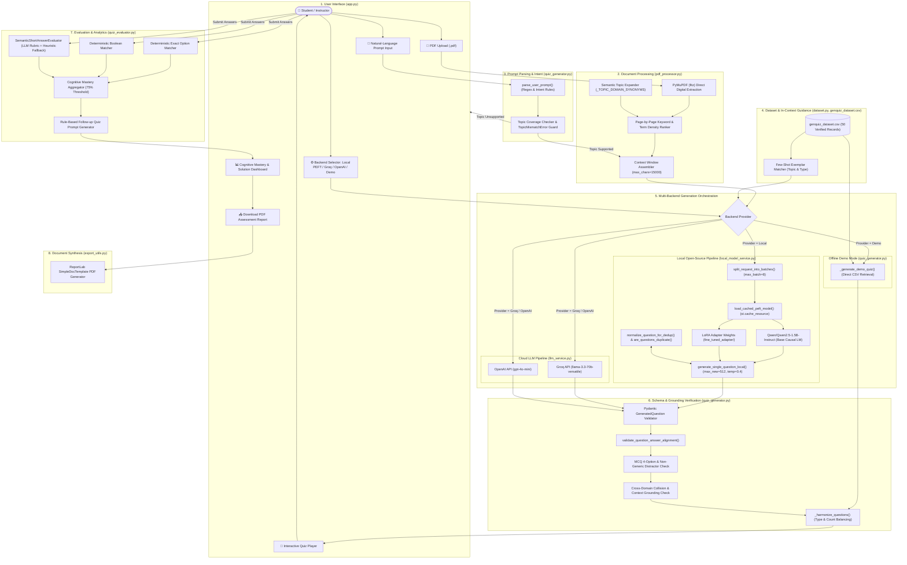
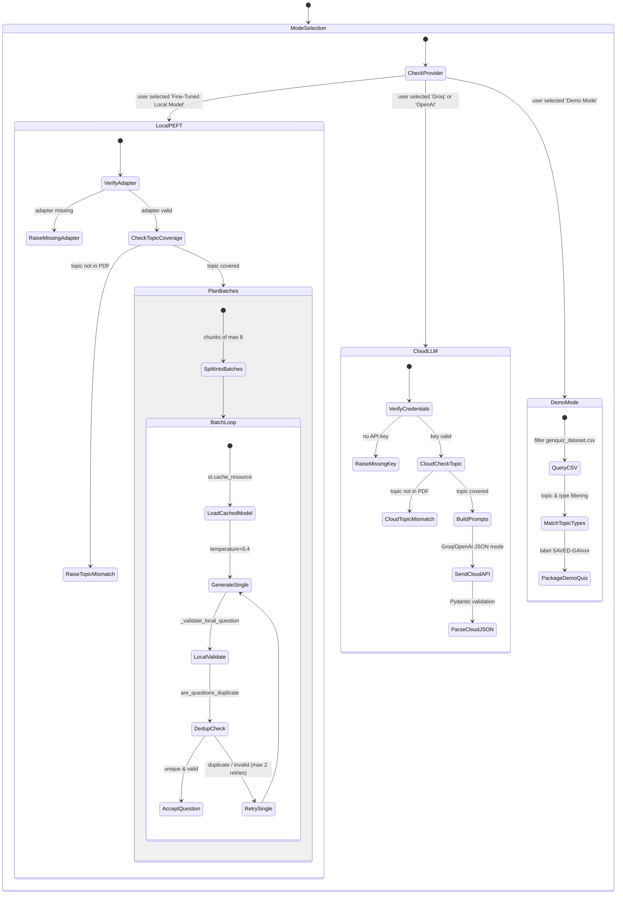
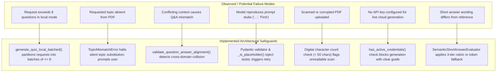

# GenQuiz — System Architecture & Workflow Specification

This document provides a verified, comprehensive technical specification of the architecture, data flow, component interactions, and execution pathways of **GenQuiz — Adaptive Generative AI-Based Quiz Generation and Personalized Assessment System**.

All descriptions, diagrams, and file references reflect the verified implementation in repository `D:\GenQuiz`.

---

## 1. High-Level Architecture Overview

GenQuiz connects an educational document ingestion pipeline, natural-language prompt interpretation, multi-backend question generation (with automatic batching for local inference), strict structural and semantic validation, interactive assessment delivery, semantic evaluation, and PDF report export.

---

## 2. Core Execution Pathways

GenQuiz provides three strictly separated generation pathways. The system never transparently or silently falls back to external cloud APIs when local mode is selected.

---

## 3. End-to-End Data Flow Pipeline

### Step 1: Document Upload & PyMuPDF Ingestion
- **File**: [`pdf_processor.py`](file:///d:/GenQuiz/pdf_processor.py)
- **Input**: Digital PDF stream or file path.
- **Process**:
  - `extract_text_from_pdf()` opens the document via `pymupdf.open()`.
  - Reads page-by-page text.
  - Scanned PDF detection: if total extracted characters $< 50$, flags document as non-selectable image/scanned PDF without OCR support.
  - Limits context to `max_chars = 15000` to prevent context window exhaustion.
- **Output**: Dictionary with `text`, `page_texts`, `page_count`, `preview`, `is_valid`.

### Step 2: Natural-Language Instruction Parsing
- **File**: [`quiz_generator.py`](file:///d:/GenQuiz/quiz_generator.py)
- **Function**: `parse_user_prompt(prompt_text)`
- **Parsing Strategy**:
  - **Difficulty**: Regex word-boundary check (`\b(medium|intermediate|moderate)\b` $\to$ `Medium`; `\b(easy|basic)\b` $\to$ `Easy`; `\b(hard|advanced)\b` $\to$ `Hard`). Explicitly prevents collision with the word *"difficulty"*.
  - **Count**: Regex matching digits before *"questions"* or after *"generate/create"*. Clamped to $[1, 30]$.
  - **Question Types**: Detects counts for MCQs, Short Answer, and True/False. If type counts are explicitly given (e.g. 9 MCQs and 4 Short Answer), total count is automatically updated to the sum ($9 + 4 = 13$).
  - **Topic Extraction**: Extracts topic phrase following *"about|on|regarding|covering"*, stripping filler phrases like *"from this pdf"*.

### Step 3: Semantic Topic Grounding & Topic Mismatch Guard
- **Files**: [`pdf_processor.py`](file:///d:/GenQuiz/pdf_processor.py), [`quiz_generator.py`](file:///d:/GenQuiz/quiz_generator.py)
- **Policy**:
  - `get_topic_related_terms(topic)` extracts substantive stems and domain synonyms via `_TOPIC_DOMAIN_SYNONYMS` (e.g., *Transformers* expands to *self-attention, multi-head, encoder, decoder*).
  - `prioritize_topic_passages()` ranks pages by keyword density.
  - **Mismatch Guard**: If total matches across all pages is 0 and mode is Live (Local or Cloud), `QuizGenerator` raises `TopicMismatchError`. The system **never** silently generates questions about an unrelated subject.

### Step 4: Multi-Batch Local Model Generation
- **File**: [`local_model_service.py`](file:///d:/GenQuiz/local_model_service.py)
- **Orchestration**:
  - `split_request_into_batches(target_count, type_counts, target_types, max_batch_size=8)` splits requests $> 8$ into safe chunks (e.g., 15 $\to$ 8 + 7; 20 $\to$ 8 + 8 + 4).
  - Preserves exact question-type ratios across batches.
  - Calls `generate_quiz_local()` sequentially with `existing_questions` passed for cross-batch deduplication.
  - Deduplication via `are_questions_duplicate()` (Jaccard token similarity $\ge 0.8$ or exact normalized text).
  - Single-question generation via `generate_single_question_local()` with prompt schema free of literal stubs, temperature $= 0.4$, and maximum 512 new tokens.

### Step 5: Question-Answer Alignment & Pydantic Validation
- **File**: [`quiz_generator.py`](file:///d:/GenQuiz/quiz_generator.py)
- **Validators**:
  - [`GeneratedQuestion`](file:///d:/GenQuiz/quiz_generator.py#L190): Rejects placeholder values (`"..."`, `"<question>"`) and questions $< 10$ characters.
  - `validate_question_answer_alignment()`:
    - **MCQs**: Exactly 4 options (A, B, C, D), distinct, non-generic (rejects *"First", "Second"*), and `correct_answer` $\in \{A, B, C, D\}$.
    - **True/False**: `correct_answer` $\in \{"True", "False"\}$.
    - **Short Answer**: Rejects cross-domain collisions (e.g., question discussing cybersecurity with an answer discussing transformer positional encoding) and ungrounded answers whose substantive tokens do not appear in the question or source passage.
  - `_harmonize_questions()`: Balances question types to match the requested distribution and assigns sequential IDs `Q1` to `QN`.

### Step 6: Interactive Quiz Attempt & Answer Collection
- **File**: [`app.py`](file:///d:/GenQuiz/app.py)
- **UI Architecture**:
  - Native Streamlit containers (`st.container(border=True)`) guarantee readable contrast across both Light Mode and Dark Mode.
  - User answers stored in `st.session_state.user_answers` keyed by `q.question_id`.

### Step 7: Dual-Mode Quiz Evaluation & Cognitive Mastery Analytics
- **File**: [`quiz_evaluator.py`](file:///d:/GenQuiz/quiz_evaluator.py)
- **Scoring Pipeline**:
  - **MCQ**: Exact option letter and normalized option text match ($1.0$ or $0.0$).
  - **True/False**: Exact boolean match ($1.0$ or $0.0$).
  - **Short Answer**: `SemanticShortAnswerEvaluator.evaluate_batch()`:
    - 3-tier scoring: Full Credit ($1.0$), Partial Credit ($0.5$), No Credit ($0.0$).
    - AI Semantic Rubric evaluates conceptual accuracy, key concepts identified, and key concepts missed.
    - Automatic transparent heuristic fallback based on substantive content-token overlap if offline or model call fails.
  - **Cognitive Mastery Analytics**:
    - Calculates topic-level accuracy.
    - Flags topics with accuracy $< 75\%$ as **Weak Areas**.
    - Generates rule-based adaptive recommendations proposing target prompts for foundational reinforcement.

### Step 8: PDF Assessment Report Export
- **File**: [`export_utils.py`](file:///d:/GenQuiz/export_utils.py)
- **Engine**: ReportLab `SimpleDocTemplate` creates printable, styled assessment reports containing student scores, cognitive mastery breakdown, solutions, and explanations.

---

## 4. Component Responsibility Matrix

| Component File | Primary Class / Functions | Responsibilities | Key Upstream | Key Downstream |
|---|---|---|---|---|
| [`app.py`](file:///d:/GenQuiz/app.py) | Streamlit UI Script | Main presentation layer, session state management, user input collection, progress alerts, dark/light contrast rendering. | User browser | All core modules |
| [`pdf_processor.py`](file:///d:/GenQuiz/pdf_processor.py) | `extract_text_from_pdf()`, `prioritize_topic_passages()`, `get_topic_related_terms()` | PyMuPDF extraction, context windowing, domain synonym expansion, page ranking by topic density. | PDF upload | `quiz_generator.py` |
| [`dataset.py`](file:///d:/GenQuiz/dataset.py) | `DatasetManager` | Loads and validates `genquiz_dataset.csv`, schema verification, few-shot exemplar retrieval, topic-matched record filtering. | `genquiz_dataset.csv` | `quiz_generator.py`, `app.py` |
| [`prepare_dataset.py`](file:///d:/GenQuiz/prepare_dataset.py) | `convert_csv_to_sft_format()`, `split_dataset_stratified()` | Validates 50 CSV rows, formats into conversational SFT JSONL with system/user/assistant turns, stratified 80/20 train/val split. | `genquiz_dataset.csv` | `data/train_sft.jsonl`, `data/val_sft.jsonl` |
| [`quiz_generator.py`](file:///d:/GenQuiz/quiz_generator.py) | `QuizGenerator`, `parse_user_prompt()`, `GeneratedQuiz`, `GeneratedQuestion`, `validate_question_answer_alignment()` | Natural language prompt interpretation, topic mismatch enforcement, multi-batch local routing, Pydantic schema validation, Q&A alignment check. | `pdf_processor.py`, `dataset.py`, `local_model_service.py`, `llm_service.py` | `app.py`, `quiz_evaluator.py` |
| [`local_model_service.py`](file:///d:/GenQuiz/local_model_service.py) | `load_cached_peft_model()`, `generate_single_question_local()`, `generate_quiz_local()`, `generate_quiz_local_batched()`, `split_request_into_batches()` | GPU/CPU loading of Qwen2.5-1.5B + LoRA adapter, single-batch inference (max 8), multi-batch orchestration (e.g. 15 or 20 questions), cross-batch deduplication. | `fine_tuned_adapter/` | `quiz_generator.py` |
| [`llm_service.py`](file:///d:/GenQuiz/llm_service.py) | `LLMService` | Cloud API interface for Groq (`llama-3.3-70b-versatile`) and OpenAI (`gpt-4o-mini`), credential detection, masked key display. | `.env` / UI key input | `quiz_generator.py`, `quiz_evaluator.py` |
| [`quiz_evaluator.py`](file:///d:/GenQuiz/quiz_evaluator.py) | `QuizEvaluator`, `SemanticShortAnswerEvaluator` | Deterministic objective evaluation, AI semantic short-answer rubric with fallback, cognitive mastery analysis, adaptive recommendations. | User answers, `GeneratedQuiz` | `app.py`, `export_utils.py` |
| [`export_utils.py`](file:///d:/GenQuiz/export_utils.py) | `generate_assessment_pdf()` | ReportLab document synthesis, score card tables, question solutions, and cognitive mastery formatting for printable export. | `GeneratedQuiz`, evaluation result | `app.py` (download button) |

---

## 5. Failure Modes & Safeguards

