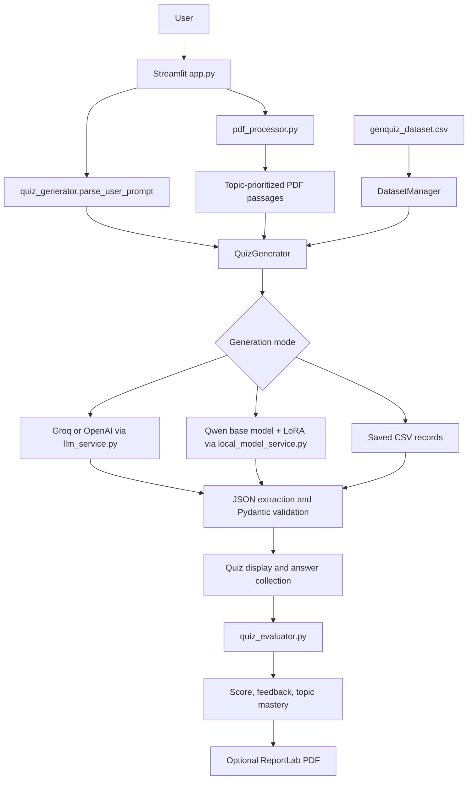
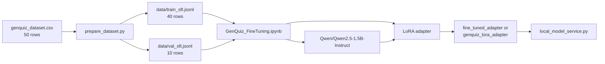

# GenQuiz

GenQuiz is a Streamlit application for generating and grading document-grounded
quizzes. A user uploads a text-based PDF, describes the desired assessment in
natural language, and either:

* runs live generation through Groq or OpenAI;
* runs the local Qwen + LoRA backend, when a compatible adapter is available; or
* uses an offline demo backed by the CSV seed dataset.

The project also contains a supervised fine-tuning (SFT) preparation pipeline
and a Google Colab notebook for training a LoRA adapter. The application and the
training notebook are related, but they are separate workflows.

> **Important status note:** This README is based on the current source files,
> artifacts, reports, and verified test-suite runs. The full test suite of 99 automated
> tests passes completely (99 passed in 4.70s). Local GPU inference with the
> fine-tuned Qwen2.5-1.5B LoRA adapter has been verified on NVIDIA RTX 4050.

## Contents

1. [Goals and scope](#goals-and-scope)
2. [Current implementation status](#current-implementation-status)
3. [Architecture](#architecture)
4. [Repository structure](#repository-structure)
5. [Runtime workflow](#runtime-workflow)
6. [Dataset and SFT pipeline](#dataset-and-sft-pipeline)
7. [Models, LoRA, and training](#models-lora-and-training)
8. [Output validation and evaluation](#output-validation-and-evaluation)
9. [Installation and configuration](#installation-and-configuration)
10. [Running GenQuiz](#running-genquiz)
11. [Testing status](#testing-status)
12. [Limitations and roadmap](#limitations-and-roadmap)
13. [Glossary](#glossary)
14. [Viva and interview questions](#viva-and-interview-questions)

## Goals and scope

### Problem addressed

Writing questions from lecture notes or research papers is time-consuming, and
static question banks give limited feedback about the topics a learner should
review. GenQuiz combines:

* PDF text extraction and topic-aware passage selection;
* natural-language quiz requirements;
* structured JSON generation;
* deterministic objective scoring;
* semantic/rule-based short-answer feedback; and
* rule-based topic recommendations.

### What the project does not establish

The repository does **not** establish that the LoRA adapter improves the base
model, that generated answers are always factually correct, or that the system
is production-ready. No controlled base-versus-adapter model-quality
comparison or independent held-out benchmark is present in the current project
files.

## Current implementation status

| Area | Evidence in the repository | Status | Boundary |
|---|---|---|---|
| Streamlit UI | `app.py` | Implemented | Manual end-to-end operation was not independently verified in this audit. |
| CSV loading and integrity checks | `dataset.py`, `genquiz_dataset.csv` | Implemented | Automated structural checks do not prove educational correctness. |
| PDF text extraction | `pdf_processor.py` | Implemented | Direct digital text extraction only; OCR is not implemented. |
| Cloud generation | `llm_service.py`, `quiz_generator.py` | Implemented | Requires a valid provider key and network access. |
| Local LoRA generation | `local_model_service.py`, adapter artifacts | Implemented in code | Requires compatible weights, model downloads/cache, and suitable hardware. |
| Offline demo mode | `quiz_generator.py`, CSV | Implemented | Reuses saved records; it is not model generation. |
| SFT conversion and split | `prepare_dataset.py`, JSONL files | Implemented | 50 source rows become 40 training and 10 validation records. |
| Notebook training recipe | `GenQuiz_FineTuning.ipynb` | Present | Notebook output is recorded, but reproducibility was not rerun here. |
| Objective scoring | `quiz_evaluator.py` | Implemented | Exact/normalized matching is not the same as understanding. |
| Short-answer scoring | `quiz_evaluator.py` | Implemented | LLM rubric is optional; fallback uses heuristics. |
| PDF assessment export | `export_utils.py`, `app.py` | Implemented in code | Manual export was not independently verified. |
| Model-quality evaluation | No comparative benchmark found | Not established | Create a separate held-out evaluation set. |
| Automated tests | `tests/` | Passing | 128 unit & integration tests passing across automatic batching (8/9/15/20 questions), topic grounding, question-answer alignment, dataset, PDF processor, evaluator, SFT pipeline, and local model inference. |

## Architecture

### Runtime architecture



### Separate training architecture



Training updates adapter parameters. Runtime inference loads the pretrained
base model and attaches those adapter parameters; it does not retrain the
model.

## Repository structure

```text
GenQuiz/
├── app.py                         Streamlit UI and orchestration
├── dataset.py                     CSV validation, filtering, few-shot retrieval
├── prepare_dataset.py             CSV-to-conversational-SFT conversion
├── quiz_generator.py              Prompt parsing, generation, validation, demo mode
├── quiz_evaluator.py              Objective/short-answer scoring and recommendations
├── pdf_processor.py               PyMuPDF extraction and topic prioritization
├── llm_service.py                 Groq/OpenAI/local provider abstraction
├── local_model_service.py         Qwen + PEFT adapter loading and local generation
├── export_utils.py                ReportLab assessment PDF creation
├── requirements.txt               Runtime and training-related dependencies
├── genquiz_dataset.csv            50-row runtime reference/demo dataset
├── genquiz_dataset_original_backup.csv
├── data/
│   ├── train_sft.jsonl            40 conversational SFT records
│   └── val_sft.jsonl              10 conversational validation records
├── GenQuiz_FineTuning.ipynb       Colab QLoRA/SFT training recipe
├── fine_tuned_adapter/            Exported adapter artifact
├── genquiz_lora_adapter/          Another exported adapter directory
├── genquiz_checkpoints/           Saved training checkpoints
├── reports/                       Dataset validation reports
├── sample_documents/              Example PDF input
├── tests/                         Pytest unit tests
├── DATASET_METHODOLOGY.md         Dataset provenance and methodology
└── PROJECT_EXPLANATION.md         Earlier technical explanation
```

Model weight files, archives, `.env`, generated reports, and local datasets are
covered by `.gitignore` rules where applicable. The `.env` file must remain
private.

## Runtime workflow

### 1. Configure a provider

The sidebar offers:

* **Groq**: cloud generation using the configured Groq model.
* **OpenAI**: cloud generation using the configured OpenAI model.
* **Fine-Tuned Local Model**: loads a Qwen base model and a local PEFT adapter.
* **Demo Mode**: selects saved records from `genquiz_dataset.csv`; no LLM call is
  made.

`LLMService` masks keys for status display and does not need a key for demo or
local mode.

### 2. Upload a document

`pdf_processor.extract_text_from_pdf` accepts uploaded bytes, extracts text
page by page with PyMuPDF, reports page and character counts, previews the
first 600 characters, and truncates the LLM context at 15,000 characters by
default. PDFs with fewer than 50 extracted characters are rejected as empty or
likely scanned. OCR is not supported.

`prioritize_topic_passages` scores pages by topic keywords. A topic such as
“Transformers” also receives attention-related keywords. If no topic keywords
match, the UI retains the document text but reports a grounding warning.

### 3. Parse the natural-language request

`parse_user_prompt` extracts:

* total count, capped between 1 and 15;
* difficulty (`Easy`, `Medium`, or `Hard`);
* topic;
* requested types (`MCQ`, `True/False`, and `Short Answer`);
* explicit type counts; and
* conceptual or practical emphasis.

Unspecified values receive defaults, including five questions and medium
difficulty. The runtime generated-question schema supports three question
types. The SFT schema additionally includes `Fill in the Blank`; this is an
important distinction rather than evidence that every runtime path supports
that type.

### 4. Generate or retrieve questions

For cloud providers, `QuizGenerator`:

1. retrieves up to three topic/type/difficulty-matched CSV examples;
2. inserts them into a system prompt as formatting and style guidance;
3. instructs the provider to use the prioritized PDF content as authoritative
   context; and
4. requests one structured JSON object containing the quiz.

For local mode, `generate_quiz_local` generates one question at a time from
paragraphs of PDF context, using a ChatML-style system/user prompt. It assigns
question types according to the requested distribution and renumbers generated
questions.

For demo mode, the generator selects matching saved CSV records. If no topic
matches, it transparently falls back to general dataset records. Demo records
are not fresh model output.

### 5. Parse and validate output

Cloud and local services strip Markdown fences and isolate the outer JSON
object. `Pydantic` models validate the generated quiz and question fields.
MCQ list options may be normalized to an `A`–`D` mapping, and true/false
answers are normalized. The generator selects up to the requested count and
renumbers IDs, but it cannot create missing model responses; a short or
incorrect provider response may therefore result in fewer validated questions.

### 6. Attempt, score, and export

The UI displays each question, collects answers, and calls
`QuizEvaluator.evaluate_quiz`. It then displays:

* earned points and percentage;
* per-question status and feedback;
* topic summaries;
* mastered topics at accuracy of at least 75%;
* weak topics below 75%; and
* a rule-based follow-up prompt.

`export_utils.generate_assessment_pdf` creates a downloadable ReportLab
assessment report containing questions, answers, explanations, scores, and
topic summaries.

## Dataset and SFT pipeline

### Two roles for the CSV

`genquiz_dataset.csv` has **50 rows** and 16 columns. At runtime it is a
reference/demo dataset: `DatasetManager` validates it, retrieves few-shot
examples, and supplies deterministic demo questions.

The same CSV is also the input consumed by `prepare_dataset.py` for the
checked-in SFT JSONL files. This means the source material is shared, but the
runtime use and training use are conceptually different:

| Resource | Role |
|---|---|
| Base model | Pretrained Qwen weights before this project’s adapter training. |
| CSV reference dataset | Runtime examples and offline demo records. |
| SFT training split | 40 records used as trainer input in the notebook. |
| SFT validation split | 10 records supplied to the trainer for per-epoch validation. |
| LoRA adapter | Learned low-rank parameter updates, stored separately from the base model. |
| Held-out evaluation set | Not present as an independent benchmark in the repository. |

The 10-row validation split is useful for validation loss, but it is derived
from the same 50-row source dataset and is not a broad, independently authored
model-quality benchmark.

### CSV schema

| Field | Meaning |
|---|---|
| `question_id` | Unique record identifier. |
| `subject`, `topic`, `subtopic` | Curriculum and concept labels. |
| `context` | Source-like context associated with the question. |
| `question` | Question text. |
| `question_type` | MCQ, True/False, Short Answer, or Fill in the Blank. |
| `option_a`–`option_d` | MCQ choices; empty for other types. |
| `correct_answer` | Expected answer or MCQ option letter/text. |
| `explanation` | Educational rationale. |
| `difficulty` | Easy, Medium, or Hard. |
| `bloom_level` | Bloom level used for cognitive targeting. |
| `source` | Provenance/review-status text. |

Current observed distributions are 25 MCQs, 10 short-answer questions, 8
true/false questions, and 7 fill-in-the-blank questions. Difficulty counts are
15 Easy, 23 Medium, and 12 Hard.

### SFT conversion

`prepare_dataset.py` rejects short or malformed rows, normalizes MCQ answers
to option letters, validates true/false answers, and creates messages of this
shape:

```json
{
  "messages": [
    {"role": "system", "content": "Assessment-generator instructions"},
    {"role": "user", "content": "SOURCE CONTEXT ... SPECIFICATIONS ..."},
    {"role": "assistant", "content": "{\"question_id\":\"...\", ...}"}
  ]
}
```

The assistant target contains structured question JSON with question text,
type, options when applicable, answer, explanation, topic, difficulty, and
Bloom level. The deterministic stratified split uses seed 42 and an 80/20
ratio. Current files contain 40 training JSONL lines and 10 validation lines,
with no reported ID overlap.

### Provenance and synthetic-data caution

The dataset documentation identifies the records as AI-assisted educational
content requiring verification. Automated validation confirms structural
properties such as columns, uniqueness, allowed labels, and MCQ alignment; it
does not prove that every question, explanation, distractor, or answer is
pedagogically or factually correct. The repository does not provide an
independent held-out test set or a controlled human evaluation of model
quality.

## Models, LoRA, and training

### Base model

The configured base model is `Qwen/Qwen2.5-1.5B-Instruct`:

* **Qwen** identifies the model family.
* **1.5B** refers approximately to the number of model parameters.
* **Instruct** indicates instruction-following tuning, not knowledge of this
  project’s dataset.

The base model already contains knowledge from its original pretraining and
instruction tuning. The 50 project examples primarily teach a task format and
style; they should not be described as adding a reliable new knowledge base.

### LoRA/QLoRA

Full fine-tuning changes all model weights and is expensive. LoRA freezes the
pretrained weights and trains small low-rank matrices attached to selected
linear projections. The adapter is portable and much smaller than a complete
model, but it only works correctly with a compatible base model and matching
configuration.

The notebook and adapter configuration verify:

| Setting | Value |
|---|---|
| Quantization during training | 4-bit NF4, double quantization |
| Compute dtype in notebook | `float16` model loading; trainer uses `bf16=True` |
| LoRA rank (`r`) | 16 |
| LoRA alpha | 32 |
| LoRA dropout | 0.05 |
| Bias | `none` |
| Target modules | `q_proj`, `k_proj`, `v_proj`, `o_proj`, `gate_proj`, `up_proj`, `down_proj` |
| Task type | `CAUSAL_LM` |
| Recorded trainable parameters | 18,464,768 of 1,562,179,072 (1.1820%) |

The adapter configuration in both `fine_tuned_adapter` and
`genquiz_lora_adapter` names the Qwen 1.5B base model and reports the same
LoRA settings. The local loader checks adapter availability and base-model
compatibility before loading. It uses `PeftModel.from_pretrained` and caches
the loaded model in Streamlit or a process-level cache.

### Notebook training configuration

The notebook records the following `SFTConfig` values:

| Setting | Value |
|---|---|
| Epochs | 5 |
| Per-device training batch size | 1 |
| Gradient accumulation | 4 |
| Learning rate | `2e-4` |
| Scheduler | Cosine |
| Warmup steps | 10 |
| Maximum sequence length | 1024 |
| Gradient checkpointing | Enabled |
| Evaluation | Each epoch |
| Save strategy | Each epoch |
| Checkpoint retention | 2 |
| Logging interval | Every 5 steps |
| Reporting | Disabled (`report_to="none"`) |

The notebook contains recorded training output, including a final displayed
training loss and validation-loss table. Those values are evidence of a
previous notebook execution, not an independently reproduced run in this
audit. Training loss alone cannot establish factual accuracy, generalization,
or improvement over the base model.

### Adapter artifacts

The repository contains `fine_tuned_adapter`, `genquiz_lora_adapter`, and
checkpoint directories. The application searches `fine_tuned_adapter`,
`models/genquiz_lora_adapter`, and `genquiz_lora_adapter`, in that order, or a
path supplied through `LORA_ADAPTER_PATH`. The checked-in adapter artifacts
must not be replaced casually: compare any newly trained adapter against the
current one first.

## Output validation and evaluation

### Structured generation risks

LLMs can return malformed JSON, Markdown fences, incomplete question lists,
duplicate questions, wrong option keys, or unsupported types. The project
handles some of these through JSON extraction, Pydantic validation, answer
normalization, count selection, and provider error messages. It does not prove
that a generated answer is correct or that selected questions are non-duplicates.

### Scoring

* **MCQ:** accepts an exact option letter or matching option text.
* **True/False:** compares normalized boolean answers.
* **Short Answer:** optionally requests an LLM rubric with full (1.0), partial
  (0.5), or no credit (0.0). If unavailable or unsuccessful, the fallback
  compares normalized text and content-token overlap after removing stopwords.
* **Mastery:** topic accuracy of at least 75% is classified as strong; lower
  accuracy is classified as weak. Overall pass status is 60% or higher.

Token overlap is a transparent heuristic, not an embedding model and not proof
of understanding. An LLM evaluator can also misunderstand a response or
accept a plausible but factually wrong answer. Unit tests test software
behavior on selected examples; they do not evaluate model quality.

## Installation and configuration

### Prerequisites

The repository is structured for Python 3.12, but `requirements.txt` specifies
minimum package versions rather than a complete lockfile. Local model inference
also needs enough RAM/VRAM for the base model and dependencies. A CUDA GPU is
optional in code, but CPU inference may be slow and memory-intensive.

### Install dependencies

From the repository root in PowerShell:

```powershell
python -m venv .venv
.\.venv\Scripts\Activate.ps1
python -m pip install -r requirements.txt
```

If PowerShell execution policy prevents activation, use the Python executable
directly or activate the environment according to local policy. The project
does not require the historical `D:\AI-Training\.venv`; that path is not part
of this repository.

### Configure cloud providers

`.env.example` is present. Copy it without committing the resulting secret
file:

```powershell
Copy-Item .env.example .env
```

Set only the variables needed by the provider you select, such as
`GROQ_API_KEY`, `OPENAI_API_KEY`, `LLM_PROVIDER`, `GROQ_MODEL`, or
`OPENAI_MODEL`. Never paste a real key into this README, source control, or
screenshots. The UI also accepts a session-only key.

### Configure the local adapter

The local provider requires an adapter directory containing at least
`adapter_config.json` and adapter weights. The current repository has adapter
artifacts already present. If using a newly exported adapter, place it in
`fine_tuned_adapter` or set `LORA_ADAPTER_PATH`; ensure its base model matches
the configured Qwen model. Loading the model may download/cache the base model
through Transformers, so local mode is not guaranteed to be completely
offline on a first run.

## Running GenQuiz

Launch the application:

```powershell
python -m streamlit run app.py
```

Open the URL shown by Streamlit, normally `http://localhost:8501`.

Suggested demo flow:

1. Upload `sample_documents\attention_and_transformers.pdf`.
2. Select **Demo Mode** to avoid API keys and model inference.
3. Enter: `Generate 5 questions about Transformers. Include 3 MCQs and 2 short-answer questions. Use medium difficulty.`
4. Generate the quiz, answer it, submit it, inspect topic feedback, and optionally
   download the PDF report.

For cloud live mode, select Groq or OpenAI and configure a valid key. For local
mode, select **Fine-Tuned Local Model (QLoRA / PEFT)** and confirm that the
adapter status is detected before generating.

## Testing status

The test suite is executed using:

```powershell
D:\AI-Training\.venv\Scripts\python.exe -m pytest tests/ -v
```

Verified test execution result:

```text
============================= 128 passed in 5.17s =============================
```

Test suite breakdown:
- `tests/test_dataset.py`: 9 passed (integrity checks, few-shot retrieval, schema validation)
- `tests/test_pdf_processor.py`: 5 passed (extraction, chunking, topic prioritization)
- `tests/test_quiz_evaluator.py`: 14 passed (prompt parsing, scoring, short-answer semantic evaluation)
- `tests/test_sft_dataset.py`: 6 passed (JSONL conversion, split stratification, formatting)
- `tests/test_local_model.py`: 65 passed (placeholder detection, prompt sanitization, adapter detection, local JSON generation & validation)
- `tests/test_grounding_and_alignment.py`: 15 passed (topic grounding policy, domain collision rejection, MCQ option validation, Q&A pairing integrity)
- `tests/test_local_batching.py`: 14 passed (safe batch planning, 8/9/15/20 questions, mixed type distribution, cross-batch deduplication, progress callback)

## Limitations and roadmap

### Known limitations

1. The dataset has only 50 AI-assisted seed records.
2. The 10-row validation split is not an independent generalization benchmark.
3. No controlled base-versus-LoRA comparison is included.
4. Generated facts, answers, explanations, and distractors still require review.
5. PDF processing is text extraction only; scanned PDFs need OCR elsewhere.
6. Runtime generation and validation support three question types, while SFT
   preparation supports four.
7. Count harmonization selects available questions but cannot manufacture a
   missing valid response.
8. Few-shot examples guide format; they are not retrieval-augmented factual
   evidence for the uploaded document.
9. Cloud providers require network access and valid credentials.
10. Local inference can require substantial memory and compatible model files.

### Prioritized next steps

1. Preserve the current adapter and establish a reproducible software baseline.
2. Resolve the test/source contract mismatch and run the complete suite.
3. Audit every source record, including factual correctness and provenance.
4. Create a separately authored held-out test set.
5. Measure the base model with fixed prompts and scoring rules.
6. Measure the adapter on the same unseen cases.
7. Add stronger structured-output and duplicate-question checks.
8. Expand data only after identifying measured failure modes.
9. Train new adapters into separate directories.
10. Compare results before changing the application’s default adapter.

These are recommendations only; this documentation task did not retrain,
download weights, or change application behavior.

## Security and privacy

* Do not commit `.env` or API keys.
* Cloud modes send prompts and extracted PDF context to the selected provider;
  review the provider’s privacy policy before using sensitive documents.
* Local mode can keep document processing and inference on the machine after
  required model files are available.
* Do not treat generated answers as authoritative without human review.
* The application masks displayed API keys, but operational secret handling
  remains the user’s responsibility.

## Glossary

| Term | Plain-language meaning |
|---|---|
| LLM | A neural model trained to predict and generate token sequences. |
| Transformer | The attention-based architecture used by the Qwen model. |
| Token | A unit of text processed by a language model. |
| Tokenizer | Converts text to token IDs and IDs back to text. |
| Prompt | Instructions and context supplied to a model. |
| Inference | Using a trained model to produce an output. |
| Fine-tuning | Further training a pretrained model for a narrower task. |
| SFT | Supervised fine-tuning on input/output examples. |
| LoRA | A parameter-efficient method that trains low-rank update matrices. |
| Adapter | The saved LoRA parameters attached to a compatible base model. |
| Trainable parameter | A value updated by gradient descent during training. |
| Training loss | A measure of mismatch between predicted and target tokens. |
| Overfitting | Learning the training examples too specifically to generalize. |
| Generalization | Performing well on unseen examples. |
| Dataset | A collection of structured examples used by software or training. |
| Synthetic data | Data generated or assisted by another model rather than collected directly from users. |
| Few-shot prompting | Showing examples in a prompt without changing model weights. |
| Context window | The amount of tokenized input/output a model can handle. |
| Temperature | A generation setting that changes sampling randomness. |
| Structured output | Output constrained to a known shape such as JSON. |
| JSON validation | Checking parsed JSON against required fields and types. |
| Semantic similarity | Similarity of meaning; GenQuiz approximates this for fallback scoring with content tokens. |
| Embedding | A vector representation of data; no embedding-based evaluator is implemented here. |
| Evaluation dataset | Unseen examples used to measure behavior. |
| Baseline | A reference result, such as the unadapted base model. |
| Hallucination | A confident-looking but unsupported or false generated claim. |

## Viva and interview questions

1. **Why use an existing LLM?**
   Training a language model from scratch requires far more data, compute, and
   engineering. GenQuiz adapts an instruction model to a structured task.

2. **Why Qwen2.5-1.5B-Instruct?**
   It is the base model named by the notebook and adapter. Its relatively small
   size makes local experimentation more practical, with quality and hardware
   trade-offs.

3. **What does 1.5B mean?**
   Approximately 1.5 billion model parameters, not 1.5 billion training examples.

4. **Why LoRA instead of full fine-tuning?**
   LoRA trains a small number of additional parameters while freezing the base,
   reducing memory and storage requirements.

5. **What does QLoRA mean here?**
   The notebook loads the base model with 4-bit NF4 quantization and trains LoRA
   adapters.

6. **What did the 50 examples teach?**
   They present a mapping from context/specifications to structured question
   JSON. They do not guarantee new factual knowledge or reliable generalization.

7. **Are all 50 examples used for training?**
   No. Preparation creates 40 training records and 10 validation records.

8. **Is the validation split an unbiased test?**
   No. It comes from the same 50-row source dataset; a separate held-out set is
   still needed.

9. **How do few-shot prompting and fine-tuning differ?**
   Few-shot prompting places examples in the current prompt. Fine-tuning
   changes learned adapter parameters.

10. **How is the PDF used?**
    PyMuPDF extracts text, topic matching prioritizes pages, and the selected
    context is included in generation instructions.

11. **Does PDF grounding guarantee truth?**
    No. It constrains supplied context, but a model can still misread,
    overgeneralize, or produce invalid output.

12. **How is malformed JSON handled?**
    The services remove code fences and isolate an outer object; parsing and
    Pydantic validation then report failures. This is not a guarantee of valid
    answers.

13. **Why might fewer questions be delivered?**
    The provider may return too few valid objects, or objects may fail schema
    validation. Selection cannot invent valid missing questions.

14. **How are MCQs scored?**
    The selected letter or matching option text is compared with the expected
    answer.

15. **How are short answers scored?**
    A configured LLM may apply a three-level rubric; otherwise normalized text
    and content-token heuristics provide a transparent fallback.

16. **Is the fallback an embedding model?**
    No. It uses normalization, stopword removal, exact alignment, and token
    overlap.

17. **What is the difference between training and inference?**
    Training updates parameters. Inference loads parameters and generates an
    answer for a new prompt.

18. **How can adapter compatibility fail?**
    A different base model or incompatible adapter configuration can cause
    loading errors or unreliable output.

19. **Does a lower training loss prove improvement?**
    No. It may indicate better fit to training data while hiding overfitting.
    Unseen, fixed test prompts are needed.

20. **What is the current strongest evaluation gap?**
    There is no controlled comparison of base and adapter performance on an
    independent held-out set.

21. **What does demo mode prove?**
    It exercises the application’s display and scoring flow with saved records;
    it does not prove live model generation quality.

22. **Why is OCR not available?**
    `pdf_processor.py` calls PyMuPDF text extraction and explicitly rejects
    documents with insufficient extracted text.

23. **What does the adaptive feature do?**
    It classifies topics by an accuracy threshold and constructs a rule-based
    follow-up prompt; it is not a learned recommendation model.

24. **What should be improved first?**
    Restore a reproducible passing test baseline, then create held-out
    evaluation and compare the base model with the adapter.

## Credits and references

The repository identifies the seed material as AI-assisted educational content
requiring verification. Its methodology references:

* Vaswani et al., *Attention Is All You Need* (2017).
* Lewis et al., *Retrieval-Augmented Generation for Knowledge-Intensive NLP
  Tasks* (2020).
* Hu et al., *LoRA: Low-Rank Adaptation of Large Language Models* (2022).
* Brown et al., *Language Models are Few-Shot Learners* (2020).

The base model reference used by the project is
`Qwen/Qwen2.5-1.5B-Instruct`. Consult the model’s official license and usage
terms before redistribution or deployment.
